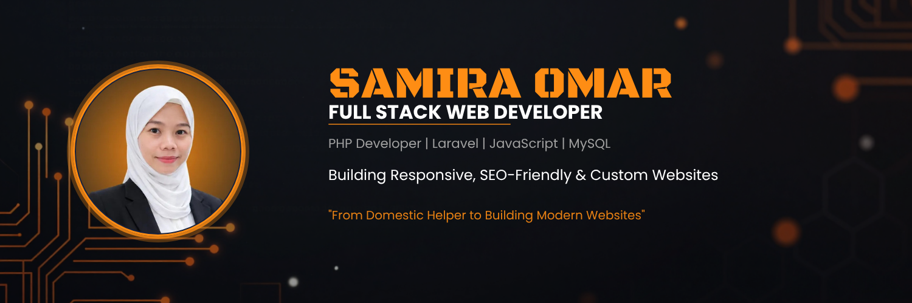

  

<h2 align="center">IT | Web Developer</h2>

  Developing responsive websites and database-driven web applications that support businesses and organizations.

  <a href="https://portfolio.samiraomar.com/">Portfolio Website</a> •
  <a href="https://www.linkedin.com/in/samira-omar/">LinkedIn</a> •
  <a href="mailto:samiraomar.xx@gmail.com">Email</a>

 

<h2>✦ My Life Philosophy</h2>

<em>"A dream without action is only a wish."</em>

  <b>Dreams become reality through discipline, courage, and consistent action.</b>

  

 

## 👋 Hi, I'm Samira Omar

I'm an **IT Diploma Graduate specializing in Web Programming**, with hands-on experience in developing responsive websites and database-driven web applications using PHP and MySQL.

My background also includes Computer Secretarial training, providing me with knowledge of Microsoft Office applications, data entry, and document management.

I'm currently seeking **entry-level IT and Web Development opportunities** where I can apply my technical skills, support digital operations, and continue growing professionally.

🌐 **Portfolio:** [portfolio.samiraomar.com](https://portfolio.samiraomar.com/)

---

## 🎓 Education

**UK Level 4 Diploma in Information Technology (Web Programming)**  
ICSA, Kuwait | 2026  

**Certificate in Computer Secretarial**  
ICSA, Kuwait | 2023  

I completed my education while working full-time, developing discipline, adaptability, time management, and a strong commitment to continuous learning.

---

## 🛠️ Technical Skills

### Frontend Development

### Backend Development

### Database Management

### Version Control and Tools

### Office Applications

Microsoft Word • Microsoft Excel • Microsoft PowerPoint • Data Entry • Document Management

### Currently Learning

Laravel • IT Support Fundamentals • Networking Basics

---

# ⭐ Featured Projects

## 🌐 Personal Business Website

 

A responsive business website showcasing my web development services, projects, technical skills, and professional background. Developed with a focus on clean design, performance, accessibility, and user experience.

**Tech Stack:**  
HTML • CSS • JavaScript • PHP

**Live Website:** [samiraomar.com](https://samiraomar.com/)

---

## 🗂️ OmarStore — Customer Management System

A database-driven web application designed to manage customer records, charges, payments, and outstanding balances. Features user login and logout, transaction management, and account balance monitoring.

**Tech Stack:**  
HTML • CSS • PHP • MySQL

**Live Application:** [omarstore.samiraomar.com](https://omarstore.samiraomar.com/)

---

## 🧋 Milk Tea Website

 

A modern milk tea ordering website featuring an interactive shopping cart, online ordering system, order tracking, and an admin dashboard for managing customer orders.

**Tech Stack:**  
HTML • CSS • JavaScript • PHP • MySQL

**Live Demo:** [milktea.samiraomar.com](https://milktea.samiraomar.com/)

---

## 💅 Nail Salon Website (Demo)

 

A modern, responsive salon website featuring Calendly booking integration, a contact form, and an embedded map for convenient client navigation and scheduling.

**Tech Stack:**  
HTML • CSS • JavaScript

**Live Demo:** [salon.samiraomar.com](https://salon.samiraomar.com/)

---

# 🏆 My Journey

My journey into technology began while working full-time in Kuwait.

Despite balancing work responsibilities and education, I pursued my interest in Information Technology and completed a UK Level 4 Diploma specializing in Web Programming.

Through independent projects, I have continued developing my skills in PHP, MySQL, responsive web design, and database management.

Today, I am focused on expanding my technical knowledge and preparing for professional opportunities in IT and web development.

My goal is to create practical digital solutions while continuously improving as an IT professional.

---

## 💡 What I Can Contribute

- **Web Development:** Building responsive, functional, and user-friendly websites.
- **Database Applications:** Developing systems for organizing and managing digital records.
- **Technical Problem-Solving:** Applying programming knowledge to practical challenges.
- **Administrative Support:** Using Microsoft Office applications and document management skills.
- **Continuous Learning:** Adapting to new technologies, tools, and workplace systems.

I believe technology should make everyday tasks simpler, more efficient, and more accessible.

---

# 📫 Let's Connect

I'm open to entry-level IT opportunities, web development projects, and professional collaborations.

  

 

<h2>✦ Thank You for Visiting</h2>

  <em>Creating practical digital solutions through technology, creativity, and continuous learning.</em>

<h3>🚀 Let's build something meaningful together.</h3>

